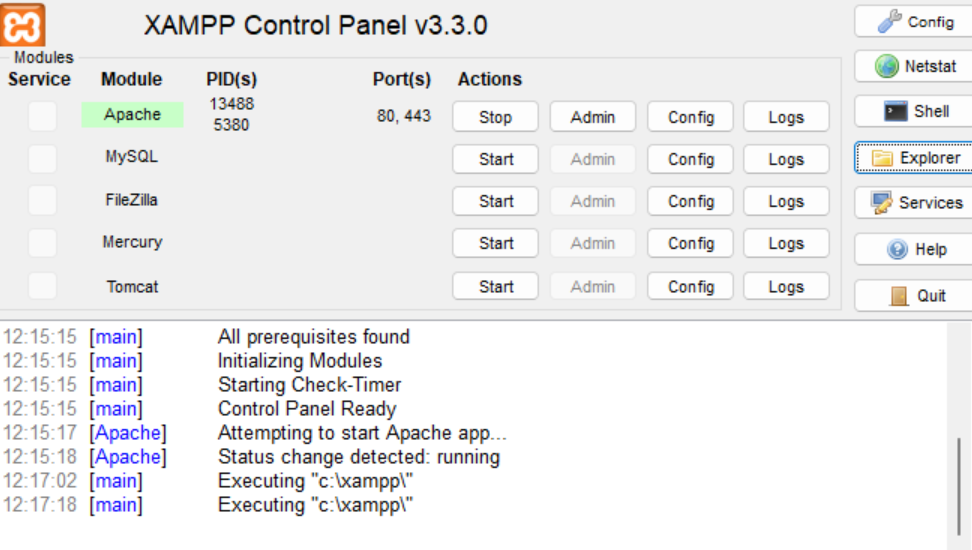

# LAPORAN PRAKTIKUM 7 – PEMROGRAMAN SERVER-SIDE DENGAN PHP

## A. Identitas Praktikum
- Nama : Amelia Futri
- Nim : 312510348
- Mata kuliah: Pemrograman Web
- Praktikum: 7
- Topik: Pemrograman Server-Side dengan PHP


***Struktur Repostory***

````
Lab7Web_PHP/
│
├── index.php
├── latihan1.php
├── latihan2.php
├── latihan3.php
├── latihan4.php
├── latihan5.php
├── latihan6.php
├── latihan7.php
│
├── eksperimen1.php
├── eksperimen2.php
├── eksperimen3.php
├── eksperimen4.php
├── eksperimen5.php
│
├── mini_project.php
├── proses_mini_project.php
│
├── screenshots/
│   ├── latihan1.png
│   ├── latihan2.png
│   ├── latihan3.png
│   ├── latihan4.png
│   ├── latihan5.png
│   ├── latihan6.png
│   ├── latihan7.png
│   ├── eksperimen1.png
│   ├── eksperimen2.png
│   ├── eksperimen3.png
│   ├── eksperimen4.png
│   ├── eksperimen5.png
│   └── mini_project.png
│
└── README.md
````
## B. Tujuan
1. Memahami client-side dan server-side.
2. Mengenali sintaks PHP dan menjalankan file PHP melalui server lokal.
3. Menggunakan variabel, tipe data, operator, percabangan, perulangan, array, dan function.
4. Menerima dan memproses data form dengan GET dan POST.
5. Melakukan validasi dan sanitasi input.
6. Membuat aplikasi sederhana yang menerima dan menampilkan data mahasiswa.

## C. Perangkat
Laptop/PC, Visual Studio Code, PHP, XAMPP atau Laragon, dan web browser.

## D. Persiapan Lingkungan
1. Instal atau siapkan XAMPP/Laragon.
2. Buka XAMPP Control Panel.
3. Klik **Start** pada Apache. Pastikan statusnya berjalan.
4. Buka folder instalasi XAMPP, lalu masuk ke folder `htdocs`.
5. Salin folder `Lab7Web_PHP` ke dalam `htdocs`.
6. Buka Visual Studio Code, pilih **File > Open Folder**, lalu pilih folder `Lab7Web_PHP`.
7. Buka browser dan akses `http://localhost/Lab7Web_PHP/latihan1/`.
8. Jangan membuka file `.php` dengan klik dua kali karena PHP perlu diproses oleh web server.

## E. Langkah Praktikum, Penjelasan, dan Hasil

### Latihan 1 – Menjalankan PHP
**Tujuan:** memastikan PHP dapat diproses oleh server lokal.

**Langkah:**
1. Buat folder `latihan1` di dalam `Lab7Web_PHP`.
2. Buat file bernama `index.php`.
3. Tulis kode pada file `latihan1/index.php`.
4. Simpan file.
5. Pastikan Apache di XAMPP dalam keadaan aktif.
6. Buka `http://localhost/Lab7Web_PHP/latihan1/`.
7. Periksa tampilan halaman.

**Penjelasan kode:** `<!DOCTYPE html>` menentukan dokumen HTML5. `h1` menampilkan judul. Tanda `<?php ... ?>` menandai bagian kode PHP. `echo` mencetak teks atau HTML ke halaman. `date("d-m-Y H:i:s")` mengambil waktu dari server.


**Hasil yang diharapkan:** muncul tulisan “Belajar PHP”, “PHP berhasil dijalankan”, dan waktu server. Kode PHP tidak terlihat sebagai teks mentah.

![hasil1.png.png/ss/hasil.png.png]

### Latihan 2 – Variabel, Operator, dan Percabangan
**Tujuan:** menghitung nilai akhir berdasarkan bobot dan menentukan predikat.

**Penjelasan kode:** tanda `$` digunakan untuk menulis variabel. Operator `*` berarti perkalian dan `+` berarti penjumlahan. Kondisi `if/elseif/else` memilih predikat sesuai rentang nilai. `number_format()` mengatur tampilan angka menjadi dua angka desimal. `htmlspecialchars()` membantu mengamankan teks saat ditampilkan dalam HTML.

![latihan2.png/ss/latihan2.png]

**Perhitungan contoh:** (85 × 0,30) + (78 × 0,30) + (90 × 0,40) = 25,5 + 23,4 + 36 = **84,9**. Berdasarkan aturan pada kode, predikatnya **B**.

![hasil2.png/ss/hasil2.png]

### Latihan 3 – Perulangan dan Array
**Tujuan:** menyimpan beberapa nama dalam array dan menampilkannya dengan perulangan.

**Penjelasan kode:** array menyimpan banyak data dalam satu variabel. `foreach ($mahasiswa as $nama)` mengambil elemen array satu per satu. `<ol>` membuat daftar bernomor, sedangkan `<li>` menjadi item daftar. `htmlspecialchars()` digunakan saat nama ditampilkan.

![latihan3.png/ss/latihan3.png]

![hasil3.png/ss/hasil3.png]

### Latihan 4 – Membuat Function
**Tujuan:** membuat fungsi untuk menjalankan proses yang dapat digunakan kembali.

**Penjelasan kode:** `function` digunakan untuk mendefinisikan fungsi. Parameter adalah nilai masukan fungsi. `return` mengembalikan hasil perhitungan ke bagian program yang memanggil fungsi. `number_format()` menampilkan nominal Rupiah dengan pemisah ribuan.

![latihan4.png/ss/latihan4.png]

![hasil4.png/ss/hasil4.png]

### Latihan 5 – Memproses Form dengan GET
**Tujuan:** menerima kata kunci melalui metode GET.

**Penjelasan kode:** GET mengirim nilai melalui parameter URL. `$_GET` merupakan variabel khusus PHP untuk mengambil data GET. `isset()` memeriksa apakah parameter tersedia. `trim()` membersihkan spasi di awal dan akhir. `htmlspecialchars()` membantu mencegah input ditafsirkan sebagai HTML/script ketika ditampilkan.

![latihan5.png/ss/latihan5.png]

![hasil5.png/ss/hasil5.png]

### Latihan 6 – Memproses Form dengan POST
**Tujuan:** mengirim nama dan program studi melalui POST.

**Penjelasan kode:** POST mengirim data pada body permintaan, bukan menampilkannya sebagai parameter URL. `$_POST` digunakan untuk mengambil data tersebut. `$_SERVER["REQUEST_METHOD"]` mengetahui metode permintaan. `required` membantu pemeriksaan di browser, tetapi pemeriksaan PHP tetap diperlukan di server.

![latihan6.png/ss/latihan6.png]

![hasil6.png/ss/hasil6.png]


### Latihan 7 – Pengolahan Data Sederhana
**Tujuan:** menghitung subtotal transaksi dari nama barang, harga, dan jumlah.

**Penjelasan kode:** `is_numeric()` memeriksa apakah nilai merupakan angka. `ctype_digit()` memeriksa apakah nilai berisi digit angka bulat. `(float)` mengubah harga menjadi tipe desimal dan `(int)` mengubah jumlah menjadi bilangan bulat. `number_format()` membantu menampilkan nominal Rupiah.

![latihan7.png/ss/latihan7.png]

![hasil7.png/ss/hasil7.png]

## F. Mini Project – Aplikasi Formulir Data Mahasiswa
**Tujuan:** membuat form yang menerima dan memvalidasi data mahasiswa.

**Penjelasan kode:** array `$error` mengumpulkan pesan kesalahan agar semuanya dapat ditampilkan sekaligus. `filter_var()` memeriksa format email. `ctype_digit()` memeriksa bahwa NIM dan semester berisi angka sesuai ketentuan. `if (!$error)` berarti data ditampilkan hanya jika tidak ada kesalahan. Function `aman()` membungkus `htmlspecialchars()` agar proses pengamanan output dapat digunakan berulang.

![mini.png/ss/mini.png]
![hasil8.png/ss/hasil8.png]

## G. Eksperimen Mandiri
1. TProgram ini digunakan untuk menghitung nilai rata-rata dari tiga komponen nilai. Ketiga nilai dijumlahkan, kemudian dibagi tiga. Hasil perhitungan ditampilkan sebagai nilai rata-rata.

![mandiri1.png/ss/mandiri1.png]
![hasil9.png/ss/hasil9.png]

2. Program ini digunakan untuk mencari nama mahasiswa dari sebuah array. Pengguna memasukkan nama melalui form, kemudian PHP memeriksa apakah nama tersebut tersedia dalam daftar. Proses pencarian menggunakan metode GET.

![mandiri2.png/ss/mandiri2.png]
![hasil10.png/ss/hasil10.png]
![hasil11.png/ss/hasil11.png]

3. Program ini menggunakan function untuk mengubah angka menjadi format mata uang Rupiah. Dengan menggunakan number_format(), angka ditampilkan dengan pemisah ribuan sehingga lebih mudah dibaca.

![mandiri3.png/ss/mandiri3.png]
![hasil12.png/ss/hasil12.png]

4. Program ini digunakan untuk memeriksa apakah NIM hanya terdiri dari angka dan memiliki panjang sesuai ketentuan. Validasi dilakukan menggunakan ctype_digit() dan strlen() agar NIM yang dimasukkan sesuai aturan.

![mandiri4.png/ss/mandiri4.png]
![hasil13.png/ss/hasil13.png]

5. Program ini menambahkan tombol reset untuk mengosongkan kembali kolom input pada form. Berbeda dengan tombol submit yang mengirimkan data ke server, tombol reset hanya mengembalikan isian form ke kondisi awal tanpa memproses ulang data di server.

![mandiri5.png/ss/mandiri5.png]
![hasil14.png/ss/hasil14.png]


## I. Jawaban Pertanyaan Evaluasi
1. **Apa perbedaan client-side dan server-side?** Client-side dijalankan di browser pengguna, sedangkan server-side dijalankan di server. PHP termasuk server-side.
2. **Mengapa file PHP harus dijalankan melalui web server?** Karena kode PHP perlu dieksekusi oleh PHP di sisi server. Web server memproses permintaan dan mengirim hasilnya ke browser.
3. **Apa fungsi tanda `$` pada variabel PHP?** Tanda `$` merupakan awalan untuk menandai nama variabel PHP.
4. **Apa perbedaan GET dan POST?** GET mengirim data melalui parameter URL, sedangkan POST mengirim data melalui body permintaan. POST bukan enkripsi.
5. **Mengapa input perlu divalidasi di server?** Karena pemeriksaan di browser dapat dilewati atau dimanipulasi. Server perlu memastikan data sesuai aturan aplikasi.
6. **Apa fungsi `htmlspecialchars()`?** Mengubah karakter khusus menjadi bentuk aman untuk HTML sehingga mengurangi risiko injeksi HTML/script saat data ditampilkan.
7. **Apa manfaat function?** Function membuat kode dapat digunakan kembali, mengurangi pengulangan, dan membuat program lebih terstruktur.

## J. Kesimpulan
Praktikum ini memberikan pemahaman mengenai pemrograman server-side menggunakan PHP. Materi yang dipelajari meliputi sintaks PHP, variabel, operator, percabangan, array, perulangan, function, serta pengolahan form menggunakan GET dan POST. Melalui latihan dan mini project, dapat dipahami bahwa validasi di sisi server diperlukan untuk memastikan data sesuai ketentuan, sedangkan `htmlspecialchars()` membantu menjaga keamanan saat data ditampilkan ke halaman HTML. Dengan demikian, PHP dapat digunakan untuk membangun aplikasi web sederhana yang menerima, memproses, dan menampilkan data pengguna.

## K. Referensi
1. Modul Praktikum Pemrograman Web, Praktikum 7: Pemrograman Server-Side dengan PHP, Program Studi Teknik Informatika.
2. PHP Manual – Getting Started: https://www.php.net/manual/en/getting-started.php
3. PHP Manual – Variables: https://www.php.net/manual/en/language.variables.php
4. PHP Manual – Functions: https://www.php.net/manual/en/language.functions.php
5. PHP Manual – Handling External Variables: https://www.php.net/manual/en/language.variables.external.php
